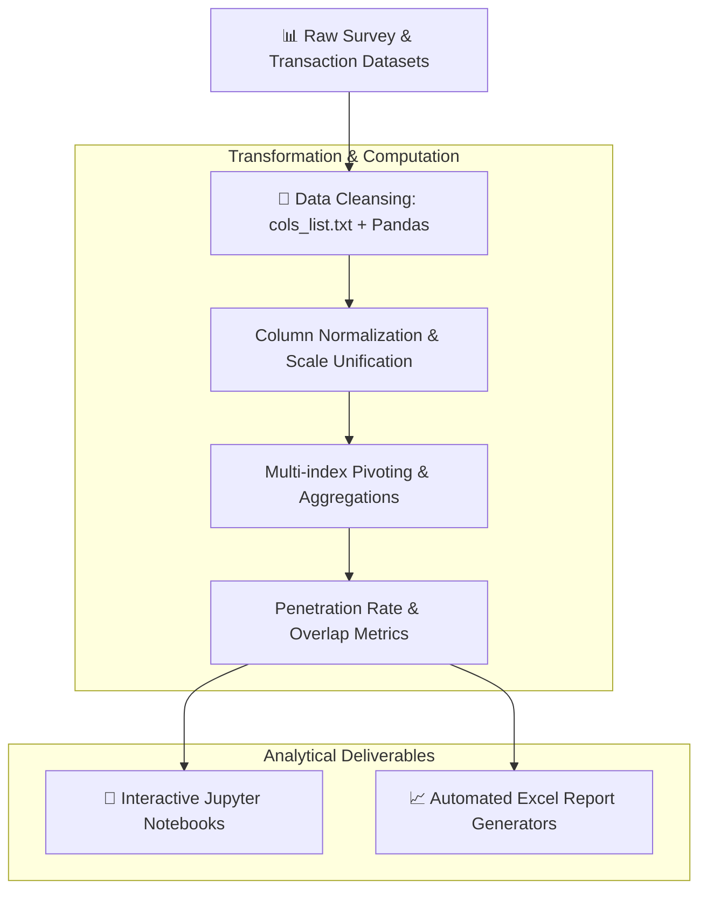

<div align="center">

# 🛒 Marketplaces & Neobanks BI Research

**Product analytics research and automated data pipeline investigating consumer adoption, trust, and penetration of marketplace neobanking services (Ozon Bank, Yandex Bank, WB Bank).**

[](https://www.python.org/)
[](https://jupyter.org/)
[](https://pandas.pydata.org/)
[](LICENSE)

[🇷🇺 Читать на русском](README.md) • [🇬🇧 Read in English](README.en.md)

---

</div>

## 📑 Table of Contents

1. [Business Context & Objectives](#1-business-context--objectives)
   * [1.1. Market Landscape](#11-market-landscape)
   * [1.2. Product Analytics Goals](#12-product-analytics-goals)
2. [Methodology & Data Pipeline Architecture](#2-methodology--data-pipeline-architecture)
   * [2.1. Pipeline Flowchart](#21-pipeline-flowchart)
   * [2.2. Data Cleaning & Transformation](#22-data-cleaning--transformation)
   * [2.3. Cross-Tabulation & Metrics Calculation](#23-cross-tabulation--metrics-calculation)
3. [Evaluated Metrics & Dimensions](#3-evaluated-metrics--dimensions)
4. [Project Structure](#4-project-structure)
5. [Technology Stack](#5-technology-stack)
6. [Installation & Execution](#6-installation--execution)
7. [Author & Contacts](#7-author--contacts)

---

## 1. Business Context & Objectives

### 1.1. Market Landscape
Major e-commerce ecosystems have developed into formidable neobanking contenders. Embedded financial offerings (Ozon Bank, Yandex Bank, Wildberries Bank) challenge legacy incumbents (Sber, T-Bank, Alfa-Bank) through frictionless checkout journeys, exclusive platform discounts, and integrated BNPL (Buy Now Pay Later) installment products.

### 1.2. Product Analytics Goals
* Evaluate customer trust regarding financial products embedded in digital marketplaces;
* Quantify the proportion of transacting users who only adopt the card for checkout discounts (transit traffic) versus those who maintain account balances and use it as a primary financial institution;
* Construct user segmentation based on purchasing frequency, basket sizes, and willingness to adopt revolving credit products.

---

## 2. Methodology & Data Pipeline Architecture

### 2.1. Pipeline Flowchart



### 2.2. Data Cleaning & Transformation
* `build_script.py` maps and aligns inconsistent column nomenclatures via `cols_list.txt`.
* Converts multi-choice categorical responses into normalized dummy/one-hot matrices for statistical validity.

### 2.3. Cross-Tabulation & Metrics Calculation
* Utilizes `pandas.crosstab` and multi-dimensional `pivot_table` engines;
* Exports styled, presentation-ready Excel deliverables with automated heatmap conditional formatting via `openpyxl`.

---

## 3. Evaluated Metrics & Dimensions

* **Penetration Rate:** Ratio of marketplace shoppers actively utilizing the brand's proprietary digital/physical debit card.
* **Churn & Friction Factors:** Key drivers behind card abandonment (UI complexity, trust deficit, lack of off-platform cashback).
* **Multi-Banking Overlap:** Overlap matrix analyzing which traditional banks share customer wallet-share with marketplace neobanks.

---

## 4. Project Structure

```text
04-marketplaces-fintech-bi/
├── Marketplaces_Report.ipynb       # Core analytical notebook with visual findings
├── Marketplaces_Automated_v3.ipynb # Automated batch processing notebook
├── generate_report.py              # Aggregation report generator script
├── v2_generate_report.py           # Second-generation formatted export daemon
├── build_script.py                 # Initial column mapping pipeline
├── cols_list.txt                   # Attribute dictionary mapping
├── requirements.txt                # Python package manifest
├── .gitignore                      # Version control exclusions
├── README.md                       # Russian documentation
└── README.en.md                    # English documentation
```

---

## 5. Technology Stack

* `Python 3.10+`
* `Jupyter Notebook`
* `Pandas` (data aggregation, cleansing, pivot tables)
* `OpenPyXL` (advanced Excel formatting and workbook automation)
* `Matplotlib & Seaborn` (statistical chart rendering)

---

## 6. Installation & Execution

```bash
git clone https://github.com/Andrew123485/marketplaces-fintech-bi.git
cd marketplaces-fintech-bi

python -m venv venv
.\venv\Scripts\activate   # Windows
source venv/bin/activate  # Linux / macOS

pip install -r requirements.txt

# Run interactive notebook
jupyter notebook Marketplaces_Report.ipynb
```

---

## 7. Author & Contacts

* **Author:** Andrei Vladimirov
* **Specialization:** Business Analyst / Product Analyst (Fintech / CIB)
* **Telegram:** [@amorfatimementomoria](https://t.me/amorfatimementomoria)
* **GitHub:** [github.com/Andrew123485](https://github.com/Andrew123485)
