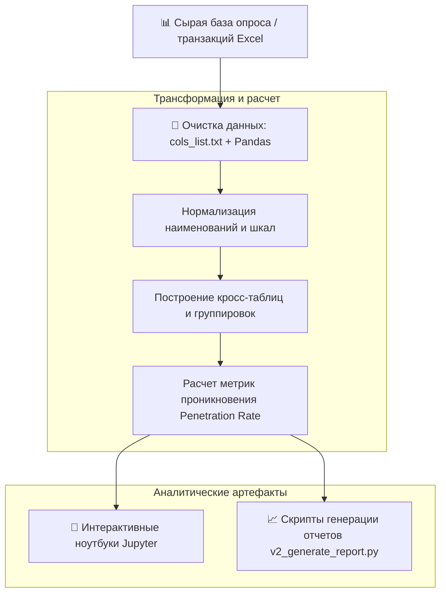

<div align="center">

# 🛒 Marketplaces & Neobanks BI Research

**Аналитическое продуктовое исследование и автоматизированный пайплайн обработки данных о восприятии финтех-сервисов банков-маркетплейсов (Ozon Банк, Яндекс Банк, WB Банк).**

[](https://www.python.org/)
[](https://jupyter.org/)
[](https://pandas.pydata.org/)
[](LICENSE)

[🇷🇺 Читать на русском](README.md) • [🇬🇧 Read in English](README.en.md)

---

</div>

## 📑 Содержание

1. [Бизнес-контекст и цели исследования](#1-бизнес-контекст-и-цели-исследования)
   * [1.1. Рыночная ситуация](#11-рыночная-ситуация)
   * [1.2. Цели продуктового анализа](#12-цели-продуктового-анализа)
2. [Методология и архитектура обработки данных](#2-методология-и-архитектура-обработки-данных)
   * [2.1. Схема аналитического пайплайна](#21-схема-аналитического-пайплайна)
   * [2.2. Очистка и трансформация сырых данных](#22-очистка-и-трансформация-сырых-данных)
   * [2.3. Кросс-табуляция и расчет метрик](#23-кросс-табуляция-и-расчет-метрик)
3. [Исследуемые метрики и срезы](#3-исследуемые-метрики-и-срезы)
4. [Структура репозитория](#4-структура-репозитория)
5. [Стек технологий](#5-стек-технологий)
6. [Установка и запуск](#6-установка-и-запуск)
7. [Автор и контакты](#7-автор-и-контакты)

---

## 1. Бизнес-контекст и цели исследования

### 1.1. Рыночная ситуация
За последние годы экосистемные маркетплейсы трансформировались в крупнейших необанковских игроков. Встроенные финансовые сервисы (Ozon Банк, Яндекс Банк, Wildberries Банк) конкурируют с классическими банковскими институтами (Сбер, Т-Банк, Альфа-Банк) за счет бесшовного клиентского пути внутри маркетплейса, эксклюзивных скидок и кредитных лимитов (BNPL / рассрочка).

### 1.2. Цели продуктового анализа
* Оценить уровень доверия пользователей к финансовым продуктам внутри e-commerce;
* Проанализировать долю клиентов, использующих карту маркетплейса только ради скидки (транзитный трафик), в сравнении с теми, кто оставляет средства на остатках и использует банк как основной;
* Построить сегментацию клиентской базы по частоте покупок, среднему чеку и готовности оформлять кредитные продукты.

---

## 2. Методология и архитектура обработки данных

### 2.1. Схема аналитического пайплайна



### 2.2. Очистка и трансформация сырых данных
* Скрипт `build_script.py` сопоставляет заголовки колонок по словарю `cols_list.txt`, устраняя опечатки и пропуски в сырых выгрузках.
* Обработка множественных ответов (Multi-choice questions) и преобразование их в бинарные dummy-переменные для корректного статанализа.

### 2.3. Кросс-табуляция и расчет метрик
* Использование `pandas.crosstab` и `pivot_table` с многоуровневыми индексами;
* Форматированная выгрузка результатов в многостраничные Excel-таблицы с автоматической раскраской тепловых карт (Heatmaps) через `openpyxl`.

---

## 3. Исследуемые метрики и срезы

* **Penetration Rate (Коэффициент проникновения):** Процент клиентов платформы, открывших виртуальную/пластиковую карту банка-маркетплейса.
* **Churn & Retention Factors:** Основные причины отказа от использования финансового сервиса (сложность интерфейса, недоверие к банку, отсутствие кэшбэка вне маркетплейса).
* **Cross-Bank Overlap:** Матрица пересечения клиентов — какими традиционными банками пользуются держатели карт маркетплейсов.

---

## 4. Структура репозитория

```text
04-marketplaces-fintech-bi/
├── Marketplaces_Report.ipynb       # Основной Jupyter ноутбук с выводами и визуализацией
├── Marketplaces_Automated_v3.ipynb # Автоматизированный ноутбук для пакетного анализа
├── generate_report.py              # Скрипт сборки агрегированных аналитических таблиц
├── v2_generate_report.py           # Вторая версия генератора форматированных отчетов
├── build_script.py                 # Пайплайн первичной нормализации колонок
├── cols_list.txt                   # Маппинг и словарь аналитических признаков
├── requirements.txt                # Зависимости Python
├── .gitignore                      # Исключения версионного контроля
├── README.md                       # Документация на русском
└── README.en.md                    # English documentation
```

---

## 5. Стек технологий

* `Python 3.10+`
* `Jupyter Notebook`
* `Pandas` (агрегации, очистка, сводные матрицы)
* `OpenPyXL` (стилизация и экспорт в Excel)
* `Matplotlib & Seaborn` (визуализация продуктовых распределений)

---

## 6. Установка и запуск

```bash
git clone https://github.com/Andrew123485/marketplaces-fintech-bi.git
cd marketplaces-fintech-bi

python -m venv venv
.\venv\Scripts\activate   # Windows
source venv/bin/activate  # Linux / macOS

pip install -r requirements.txt

# Запуск интерактивного блокнота
jupyter notebook Marketplaces_Report.ipynb
```

---

## 7. Автор и контакты

* **Автор:** Владимиров Андрей Георгиевич
* **Специализация:** Бизнес-аналитик / Продуктовый аналитик (Финтех / КИБ)
* **Telegram:** [@amorfatimementomoria](https://t.me/amorfatimementomoria)
* **GitHub:** [github.com/Andrew123485](https://github.com/Andrew123485)
